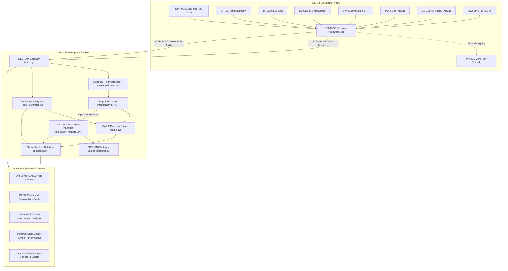
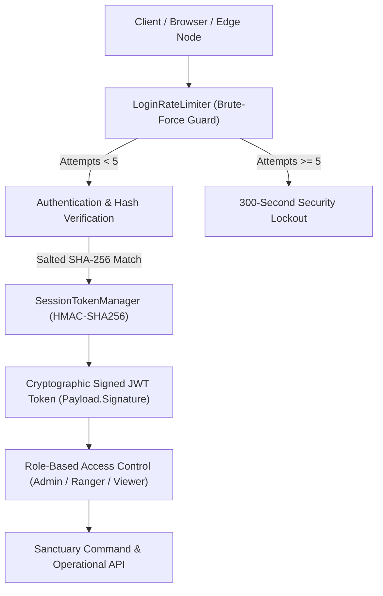

# AuraForest: System Architecture Document

---

## 1. High-Level Architecture Overview

AuraForest employs a multi-tier, edge-to-cloud architecture designed for autonomous field deployment in remote forest reserves:

---

## 2. Layer-by-Layer Architectural Breakdown

### 2.1. Edge Firmware Layer (`hardware.ino`)
- **Target Platform**: ESP32-S3 (Xtensa Dual-Core LX7 @ 240 MHz).
- **Memory Management**:
  - Internal SRAM: Dedicated to network stack, I2C/SPI drivers, and JSON buffers.
  - External Octal PSRAM: 160 KB allocated via `ps_malloc(160000)` holding 5.0 seconds of 16-bit mono 16 kHz audio.
- **Microphone DMA Engine**:
  - `I2S_NUM_0` configured in master RX mode.
  - Captures 32-bit I2S slots from INMP441, shifting `sample >> 14` to 16-bit signed PCM with clipping protection.
- **Interrupts**:
  - SW-420 piezoelectric sensor connected to GPIO 16 with `attachInterrupt(..., RISING)` ISR to latch shock events without polling.
- **Fail-Safe Persistence**:
  - Telemetry payloads that fail HTTP transmission are instantly flushed to SPI MicroSD card (`/telemetry_log.jsonl`).

---

### 2.2. Audio DSP & Environmental Sound Classification (ESC) Pipeline
1. **High-Pass DC Stripping**: 4th-order Butterworth filter at 80 Hz to eliminate wind gust rumble.
2. **Spectral Subtraction / Noise Gating**: Background environmental noise floor estimated and subtracted from stationary spectral bins.
3. **Log-Mel Feature Extraction**:
   - Sample Rate: $16,000 \text{ Hz}$
   - FFT Window: 512 samples ($32 \text{ ms}$), Hop Size: 160 samples ($10 \text{ ms}$)
   - Mel Filterbanks: 64 logarithmic bands covering 20 Hz to 8,000 Hz.
4. **Deep Neural Network Classifier**:
   - Compact MobileNetV3-Small / Lightweight CNN generating class probability vector $P(C)$ and 128D latent embedding vector $E \in \mathbb{R}^{128}$.

---

### 2.3. Multimodal Decision Engine (CADIE)
CADIE (*Context-Aware Decision Intelligence Engine*) implements **Confidence-Driven Primacy** with **Multimodal Sensor Corroboration**, **Voice-First Logging Validation**, and **Seismic vs. Acoustic Cross-Triage**:

- **Confidence Primacy Principle**:
  Acoustic prediction confidence ($C \ge 0.85$ for high-priority threats like `Chainsaw`, `Gunshot`, `Fire`) directly anchors the decision score and triggers emergency alerts autonomously. Nominal or idle hardware readings **NEVER** suppress or bottleneck high-confidence acoustic detections.
- **Voice-First Logging & Acoustic Validation**:
  Illegal logging detection strictly requires the acoustic voice of logging machinery (chainsaw, power drill, jackhammer, mechanical saw, or tree felling). Vibration alone is never mistaken for logging.
- **Seismic Vibration vs. Logging Cross-Triage**:
  - **Acoustic Voice + Seismic Vibration**: Ground shock accompanied by chainsaw/drill acoustic signatures confirms active tree cutting and heavy equipment impact. CADIE elevates this to `CRITICAL` risk with `TRANSMIT_IMMEDIATELY` and `DISPATCH_RANGERS`.
  - **Seismic Vibration Alone (No Logging Voice)**: Registered as `[SEISMIC VIBRATION] Environmental ground vibration` (possible minor tectonic tremor, animal herd stampede, or high-wind tree sway). Suppresses false logging alerts while recording the vibration telemetry.
- **Multimodal Smoke & Fire Corroboration**:
  MQ-2 (flammable gas / smoke) and MQ-135 (air quality / combustion index) sensors actively corroborate acoustic fire crackling. Significant ADC spikes ($\ge 400$ on MQ-2 or $\ge 800$ on MQ-135) or voltage deltas ($\ge 0.50\text{ V}$) trigger immediate `CRITICAL EMERGENCY` fire alerts across Chief and Ranger terminals.

$$\text{Decision Score} = \max\left(C_{\text{threat}}, \; 0.52 \cdot C + 0.22 \cdot P_{\text{event}} + 0.12 \cdot E_{\text{env}} + 0.09 \cdot S_{\text{sens}} + 0.06 \cdot \Delta_{\text{gas}} + 0.08 \cdot V_{\text{latch}}\right)$$

- **Decision Matrix**:
  - `Chainsaw / Drill Voice + Vibration Latch` $\rightarrow$ `CRITICAL (CONFIRMED LOGGING - DISPATCH_RANGERS)`
  - `Chainsaw / Drill Voice Alone (>=75%)` $\rightarrow$ `HIGH (LOGGING SUSPECTED - RECORD_EVIDENCE)`
  - `Vibration Latch Alone (No Logging Voice)` $\rightarrow$ `LOW (SEISMIC TREMOR / ENVIRONMENTAL SWAY - MONITOR)`
  - `Fire Crackle Voice + Smoke Sensor Spike` $\rightarrow$ `CRITICAL (CANOPY COMBUSTION - DISPATCH_RANGERS)`
  - `Gunshot Acoustic Signature (>=80%)` $\rightarrow$ `CRITICAL (POACHING INTRUSION - TRANSMIT_IMMEDIATELY)`
  - `Ambiguous Sound + Storm Noise` $\rightarrow$ `ELEVATED (CONFIRM_NEXT_CYCLE)`

---

### 2.4. Open-Set Unknown Discovery Engine
- **Gate Logic**: If $\max(P(C)) < \tau_{\text{conf}}$ ($0.65$) or top-1/top-2 margin $< \Delta_{\text{margin}}$ ($0.15$), the event is marked as **UNKNOWN**.
- **Embedding Ingestion**: Latent vector $E$ and WAV audio are buffered in `UnknownBuffer`.
- **DBSCAN Density Clustering**:
  - Distance metric: Cosine distance on normalized $L_2$ embeddings.
  - Parameters: $\epsilon = 0.35$, `min_samples = 3`.
  - Generates persistent cluster identifiers (`cluster-001`, `cluster-002`) ready for human ranger review in the UI.

---

### 2.5. Database Architecture (`backend/database.py`)
SQLite 3 database located at `data/runtime.db` structured with relational schemas and WAL mode:

| Table | Purpose | Key Columns |
| :--- | :--- | :--- |
| `telemetry_history` | Time-series physical sensor data | `id`, `device_id`, `timestamp`, `temperature`, `humidity`, `light_level`, `battery_percent`, `battery_voltage`, `vibration_detected`, `mq2_voltage`, `mq135_voltage`, `gas_risk_score` |
| `events` | Audio inferences & CADIE triage | `id`, `device_id`, `timestamp`, `label`, `confidence`, `risk_level`, `action`, `contributing_factors` |
| `unknown_samples` | Retained uncatalogued sounds | `sample_id`, `device_id`, `timestamp`, `cluster_id`, `embedding_json`, `audio_path` |
| `clusters` | Discovered DBSCAN sound groups | `cluster_id`, `status`, `label`, `sample_count`, `notes`, `created_at` |
| `emergency_alerts` | Dispatched high-priority threats | `alert_id`, `device_id`, `timestamp`, `created_at`, `threat_type`, `priority_tier`, `confidence`, `risk_level`, `location_lat`, `location_lon`, `status`, `acknowledged_at`, `acknowledged_by` |
| `rangers` | Field ranger directory & GPS tracking | `id`, `username`, `password_hash`, `full_name`, `callsign`, `rank`, `sector`, `email`, `phone`, `current_lat`, `current_lon`, `last_seen` |
| `citizen_reports` | Public tips, photos & dispatch workflow | `report_id`, `timestamp`, `contact`, `description`, `image_url`, `latitude`, `longitude`, `status`, `assigned_to`, `resolved_at`, `resolution_notes` |
| `experiment_logs` | Scientific propagation benchmarks | `id`, `experiment_type`, `distance_m`, `snr_db`, `accuracy`, `parameters_json` |

---

### 2.6. Command Center & Tactical Visualization Layer (`dashboard/app.py`)
- **Live Cloud Deployment**: [https://auraforest-sentinel.streamlit.app/](https://auraforest-sentinel.streamlit.app/)
- **Tactical Radar & Pydeck Map**:
  - Multi-layer 3D geospatial visualization with dynamic zoom and reserve preset centering.
  - **Node Hexagons (`[115, 217, 232]`)**: Active IoT sentinel nodes displaying battery, temperature, and gas health.
  - **Ranger Unit Pins (`[124, 240, 178]`)**: Active field ranger positions dynamically refreshed from browser GPS.
  - **Citizen Tip Beacons (`[242, 198, 109]`)**: Incident markers displaying citizen photo evidence and dispatch state.
  - **Emergency Shockwave Rings (`[255, 0, 0]`)**: Concentric dual-radius pulsing strobe halos radiating over active threat coordinates.
- **HTML5 Geolocation Sentry**:
  - Invokes `navigator.geolocation.getCurrentPosition` with `{enableHighAccuracy: true}`.
  - Seamlessly updates URL query parameters (`device_lat`, `device_lon`, `gps_acc`) and session state.
- **Spectrum Analyzer**:
  - 32-Band FFT Frequency Equalizer (20 Hz to 8 kHz) with peak hold indicators.
  - Interactive 2D Log-Mel Spectrogram Heatmap with Bio-Sentinel colormap.
  - Live acoustic metrics: Peak Frequency (Hz), Centroid (Hz), Rolloff (Hz), RMS Power (dBFS), Spectral Flatness.

---

### 2.7. Multi-Channel Emergency Dispatch & Alert Notification (`backend/alert_dispatcher.py`)
- **Automated Multi-Channel Dispatch Engine**:
  - Automatically evaluates incoming acoustic and multimodal inferences against high-confidence emergency threat criteria:
    $$\text{Trigger} = \left(\text{Threat} \in \{\text{Gunshot}, \text{Chainsaw}, \text{Fire}\} \land C \ge 0.70\right) \lor \left(\text{Risk} \in \{\text{CRITICAL}, \text{HIGH}\}\right)$$
  - **Channels**:
    1. **Edge Node Indicator**: Injects `"emergency_alert"` command payload back into the inference HTTP response, triggering on-board high-intensity visual strobe LEDs on `GPIO 15`.
    2. **Ranger Station Webhooks**: Broadcasts real-time structured JSON payloads with precise GPS coordinates, threat class, and CADIE factor evidence to base stations.
    3. **Persistent SQLite Store**: Records alerts in `emergency_alerts` table with active/acknowledged workflow.
    4. **Top Banner Flashing Strobe HUD**: Displays animated strobe alert banner on the dashboard with one-click ranger acknowledgment to silence alarms.
    5. **Mobile Phone Status Bar Push**: Instant push notifications to Android / iOS notification bars via `ntfy.sh` with custom haptic vibration and synthesized siren sound.
    6. **SMTP Email Delivery**: Automated HTML email dispatches with direct links to [https://auraforest-sentinel.streamlit.app/](https://auraforest-sentinel.streamlit.app/).

---

### 2.8. Multi-Layer Enterprise Security Architecture (`backend/security.py`)
A comprehensive, zero-trust cyber-defense architecture secures all API endpoints, edge devices, and operator sessions:

1. **Cryptographic HMAC-SHA256 Session Management (`SessionTokenManager`)**:
   - Replaces insecure plaintext URL parameters with tamper-proof HMAC-SHA256 signed session tokens containing `username`, `role`, `display_name`, `department`, `iat`, and `exp`.
   - On page refresh or deep link navigation, tokens are cryptographically verified against server secret keys.
   - Any signature tampering, forged username, or expired timestamp immediately terminates the session and purges browser query parameters.
2. **Progressive Brute-Force & Credential Stuffing Defense (`LoginRateLimiter`)**:
   - Tracks failed authentication attempts per username and client IP within a rolling 300-second window.
   - Enforces an automatic **300-second (5-minute) security lockout** upon reaching 5 failed attempts.
   - Displays live remaining cooldown countdown to legitimate users and logs all `LOGIN_FAILED`, `ACCOUNT_LOCKED`, and `LOCKOUT_BLOCKED` events in the database audit table.
3. **Password Security & Complexity Enforcement (`validate_password_strength`)**:
   - Enforces a minimum of 8 characters with required alphanumeric mix (at least one letter and one numerical digit) for all new Citizen registrations and Field Ranger credentials.
   - Hardcoded dictionary fallbacks (`admin`, `chief`, `password`, `ranger`) have been completely purged from the codebase.
4. **Input Sanitization & Injection Defense (`sanitize_xss`)**:
   - HTML-escapes all citizen report text, user notes, and ranger callsigns prior to rendering in Streamlit markdown components to prevent Cross-Site Scripting (XSS).
   - Strict SQLite parameterized queries (`?`) prevent SQL injection across all database interactions.
5. **Cyber-Defense & Security Operations Center (SOC)**:
   - Dedicated Chief Ranger dashboard tab providing real-time security shield status (`HMAC-SHA256`, `BRUTE-FORCE SHIELD`, `TELEMETRY BOUNDS`, `DATABASE HASHING`).
   - One-click emergency actions: **Unlock All Locked Accounts & IPs** and **Flush Rate Limiter**.
   - Filterable, immutable security audit trail logging every system authentication event.

---

### 2.9. Edge Audio Ingestion Resiliency & Dynamic Hotspot Firmware
1. **Audio Ingestion Resiliency**:
   - **Strict 4-Byte MPEG Header Validation**: Requires complete version, layer, bitrate, and sampling rate validation plus second-frame boundary verification before flagging incoming bytes as MP3. Eliminates false-positive MP3 classifications triggered by raw PCM16 negative ambient noise (`0xFFFF`).
   - **Resilient Fallback**: If compressed decoding ever encounters an error, the pipeline gracefully falls back to raw signed PCM16 processing without returning a 500 server error to the field node.
   - **16-Bit Alignment**: Auto-aligns odd-length incoming audio buffers to even 16-bit boundaries.
2. **Mobile Hotspot & Dynamic Captive Portal**:
   - **Mobile Hotspot Support**: Disables Wi-Fi modem sleep (`WiFi.setSleep(false)`) in `hardware.ino` to prevent mobile hotspot dropouts and packet throttling on 2.4 GHz bands.
   - **Autonomous Captive Portal AP (`AuraForest-Node-Setup`)**: If previously stored Wi-Fi credentials are unreachable, the ESP32-S3 automatically launches an Access Point at `http://192.168.4.1` with a captive DNS server. Operators can configure new Wi-Fi credentials and server IPs on-the-fly, persisted directly to non-volatile storage (`Preferences` / NVS flash).

---

### 2.10. Audible Sanctuary Public Siren Synthesizer
- **Web Audio API Emergency Synthesizer**:
  - Implements an audible sanctuary siren chime directly in the operator and citizen browser using dual Web Audio API oscillators (sawtooth carrier frequency modulated by a 2.2 Hz low-frequency oscillator).
  - Silenced cleanly and completely when muted or deactivated via audio context shutdown.
- **Ranger & Chief Siren Broadcast Controls**:
  - Field Rangers and Chief Rangers can activate the sanctuary-wide public siren (`🚨 Broadcast Siren to Public`) with instant visual and audible dispatch.
  - One-click silence button (`🔕 Silence & Deactivate Siren`) deactivates the broadcast across all connected clients.
